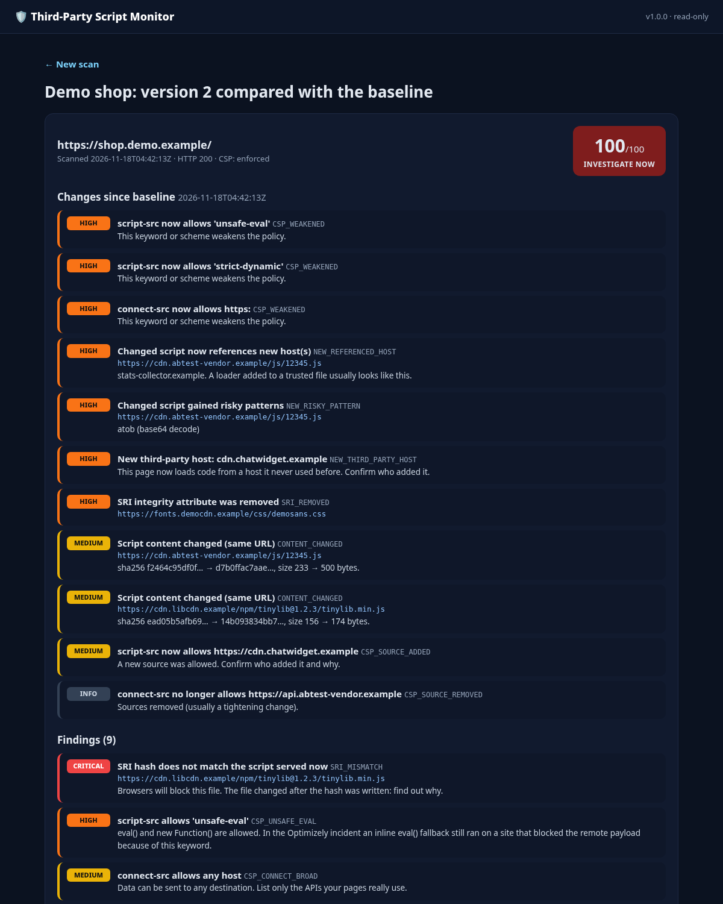
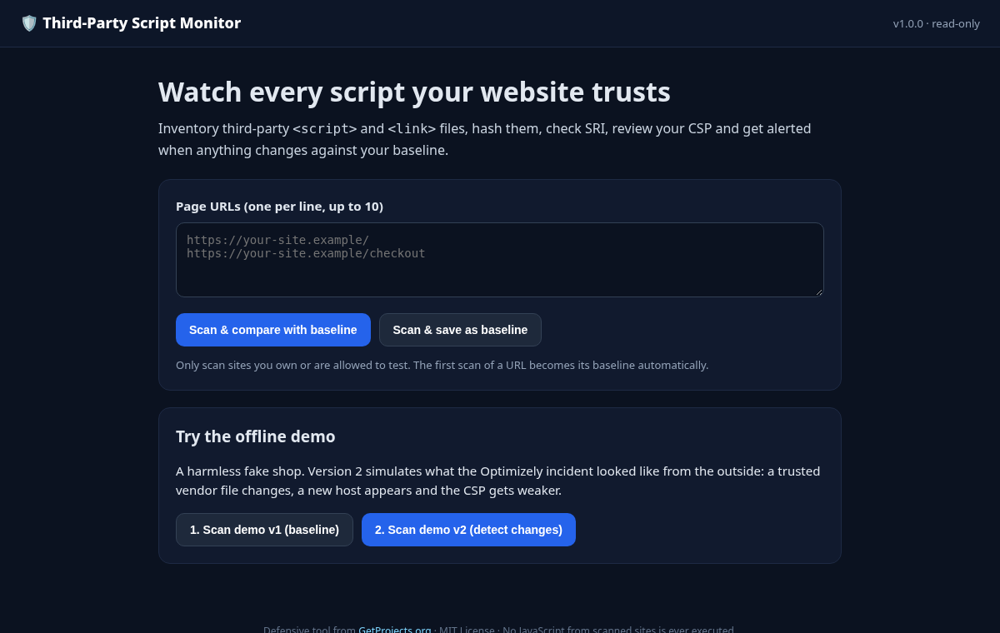
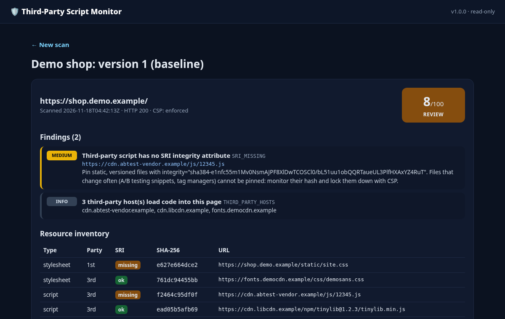
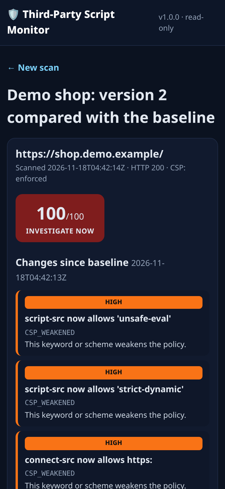
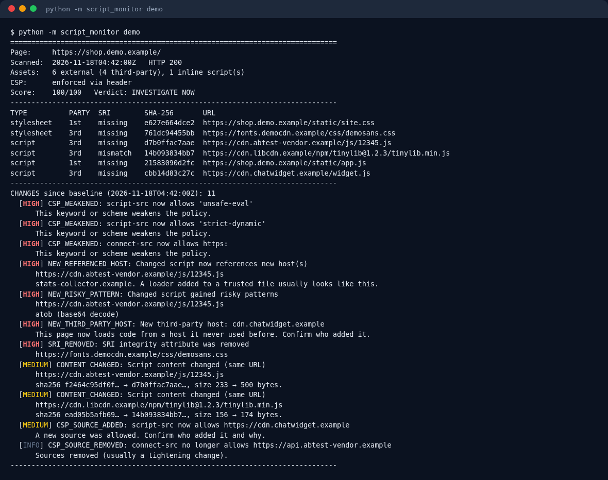

# Third-Party Script Monitor (Python) — SRI & CSP Change Detector

A **defensive, read-only** Python tool that watches the third-party JavaScript and CSS your website loads.
It inventories every external `<script>` and `<link>` on your pages, hashes each file, checks
**Subresource Integrity (SRI)**, reviews your **Content Security Policy (CSP)**, saves a **baseline**
and alerts you when anything changes: a new third-party domain, a trusted file whose hash changed, an
SRI attribute that disappeared, or a CSP that got weaker.

Built for the GetProjects tutorial:
**[Third-Party Script Monitor in Python: Detect Website Supply-Chain Attacks](https://getprojects.org/third-party-script-monitor-python/)**

> **Why now?** On 16 Nov 2026, malicious JavaScript was served to visitors of 178 organisations through
> Optimizely Web Experimentation snippets loaded from Optimizely's own CDN
> ([Report URI, 16 Nov 2026](https://blog.report-uri.com/worlds-largest-brands-infected-with-malware-via-optimizely/);
> [Optimizely incident report, 17 Nov 2026](https://pages.optimizely.com/rs/947-RKE-048/images/Security%20Incident%20Report%20-%20Optimizely%20Web%20Experimentation%20-%20Nov%2017%202026.pdf)).
> The sites themselves were not breached; a script they trusted changed. This project shows how to notice that kind of change.



## Features

- **Resource inventory**: external scripts, stylesheets, `modulepreload`/`preload` files, lazy-loaded
  `data-rocket-src` scripts (WP Rocket), plus SHA-256 hashes of inline scripts.
- **First-party vs third-party** classification (add your own CDN with `--first-party`).
- **Hashing**: SHA-256 of every file and a ready-to-paste `sha384-…` SRI value.
- **SRI checks**: missing, malformed, mismatched (file changed after the hash was written), and SRI
  without `crossorigin`.
- **CSP review**: missing policy, report-only, `'unsafe-inline'`, `'unsafe-eval'`, `'strict-dynamic'`,
  `*` and scheme sources (`https:`), missing `connect-src`, `object-src`, `base-uri`, reporting, meta-only CSP.
- **Baseline + diff**: new third-party hosts, new/removed resources, changed file hashes, new hosts
  referenced inside a changed script, new risky patterns (`eval`, `atob`, `sendBeacon`, `document.cookie`…),
  SRI removed, CSP weakened/removed/switched to report-only, changed inline scripts.
- **Reports**: coloured terminal output, JSON, and a self-contained HTML report.
- **CI-friendly**: `--fail-on high` exits with code 1; a GitHub Actions example is included.
- **Optional Flask web UI** with an offline demo.
- **Safe by design**: never executes JavaScript, GET requests only, 5 MB size limit per file, web UI binds
  to 127.0.0.1 and blocks private/loopback addresses by default.
- Core scanner and CLI use **only the Python standard library**. 27 pytest tests.

## Project structure

```
third-party-script-monitor/
├── script_monitor/
│   ├── cli.py          # scan / demo / csp / sri commands
│   ├── scanner.py      # inventory, hashing, per-resource findings
│   ├── htmlparse.py    # finds <script>, <link>, inline scripts, CSP <meta>
│   ├── sri.py          # compute and verify integrity values
│   ├── csp.py          # parse, review and compare CSPs
│   ├── baseline.py     # save baselines and diff snapshots
│   ├── fetcher.py      # HTTP fetcher + offline fixture fetcher
│   ├── findings.py     # severities, score, verdict
│   └── report.py       # text, JSON and HTML reports
├── app.py              # optional Flask web UI
├── templates/ static/  # web UI
├── examples/demo-site/ # harmless offline fixture shop (v1 and v2)
├── examples/github-actions-monitor.yml
├── tests/              # pytest suite
└── docs/screenshots/
```

## Quick start

```bash
git clone https://github.com/GetProjectsIdea/Third-Party-Script-Monitor-Python.git
cd Third-Party-Script-Monitor-Python
python -m venv .venv && source .venv/bin/activate   # Windows: .venv\Scripts\activate
pip install -r requirements-dev.txt                 # Flask + pytest (the CLI needs nothing)

python -m script_monitor demo        # offline demo, no internet needed
python -m pytest -q                  # 27 passed
```

## Usage

```bash
# First run creates the baseline, later runs compare against it
python -m script_monitor scan https://your-site.example/ https://your-site.example/checkout \
       --baseline baseline.json --html report.html --json report.json

# Accept the current state as the new "known good" baseline
python -m script_monitor scan https://your-site.example/ --baseline baseline.json --update-baseline

# Many pages, your own CDN counted as first-party, fail CI on high/critical
python -m script_monitor scan --urls-file examples/urls.txt --first-party mycdn.example \
       --baseline baseline.json --fail-on high

# Review a CSP string before you deploy it
python -m script_monitor csp "default-src 'self'; script-src 'self' 'unsafe-eval'"

# Generate SRI values for a file you are about to include
python -m script_monitor sri https://cdn.example/lib@1.2.3/lib.min.js
```

Web UI:

```bash
python app.py          # http://127.0.0.1:5000
```

| Home | Baseline (v1) | Mobile |
|---|---|---|
|  |  |  |

CLI output of the demo:



Full text output: [`docs/sample-output-demo.txt`](docs/sample-output-demo.txt).

## What the demo shows

`examples/demo-site/` contains two versions of a fake shop served by an offline fixture fetcher
(no network, reserved `.example` domains only). Version 2 simulates the outside view of a
script supply-chain incident:

| Change in v2 | What the monitor reports |
|---|---|
| Vendor A/B-testing snippet gains extra code that references a new host and calls `atob()` | `CONTENT_CHANGED`, `NEW_REFERENCED_HOST`, `NEW_RISKY_PATTERN` |
| A pinned library file changes but keeps its old `integrity` | `SRI_MISMATCH` (critical) |
| `integrity` removed from a font stylesheet | `SRI_REMOVED` |
| New chat-widget script from a new domain | `NEW_THIRD_PARTY_HOST` |
| `'unsafe-eval'`, `'strict-dynamic'` and `connect-src https:` added to the CSP | `CSP_WEAKENED` |

The demo files are harmless placeholders. Nothing in this repo is malware, and nothing is ever executed.

## How to respond to an alert

1. **New third-party host** → find who added the tag (CMS, tag manager, plugin update). Remove it if nobody can explain it.
2. **Hash changed on a vendor file** → open the file, diff it against the copy in your baseline, look for new
   hosts, `eval`, `atob`, `sendBeacon` or card/wallet keywords. Ask the vendor.
3. **SRI mismatch** → browsers already block the file; check whether the CDN copy was replaced.
4. **CSP weakened** → check your deployment history; revert keywords like `'unsafe-eval'` or `https:` that nobody approved.
5. Keep **checkout pages** free of marketing tags and take cards in the payment provider's hosted iframe.

## Hardening checklist

- Pin static, versioned third-party files with SRI (`integrity` + `crossorigin="anonymous"`).
- Self-host libraries where you can.
- Enforce a CSP with an explicit `script-src` host list and a tight `connect-src`; avoid `'unsafe-eval'`,
  `'unsafe-inline'` (use nonces/hashes), bare `https:` and `*`. Use `'strict-dynamic'` only on purpose.
- Add `object-src 'none'`, `base-uri 'self'`, and `report-to`/`report-uri` so you receive violation reports.
- Run this monitor on a schedule (cron or the GitHub Actions example) because SRI cannot pin files that change
  every time a vendor dashboard is edited.

## Limitations

- It reads HTML and files; it does not run a browser, so scripts injected at runtime by other scripts are only
  visible through the "referenced hosts" and "risky pattern" signals of the parent file. Pair it with CSP
  violation reporting for full coverage.
- Vendors may serve different content per user agent, region or A/B bucket, so some hash changes are normal.
  Review them; do not panic.
- Registrable-domain detection is an approximation (it knows common two-level suffixes such as `co.in` and `co.uk`).

## Responsible use

Scan only websites you own or are authorised to test. The tool makes ordinary GET requests, like a browser
loading a page, but respect each site's terms and rate limits.

## License

MIT © 2026 Pardeep Patel / [GetProjects.org](https://getprojects.org/)
